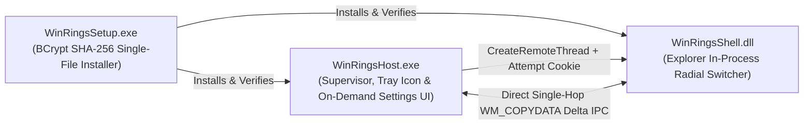

<p align="center">
  
</p>

<p align="center">
  <strong>A pure native C++17 Windows 11 Radial Switcher &amp; Gesture Launcher.</strong><br/>
  Zero .NET / CLR &middot; Instant Frame-0 Acrylic Glass &middot; Multi-Profile Rings &middot; 0% Idle GPU
</p>

<p align="center">
  <a href="https://github.com/AhmadotEng/WinRings/releases"></a>
  
  
  
  <a href="LICENSE"></a>
</p>

---

**WinRings** integrates cleanly into Windows 11 `explorer.exe` to give you an instant-opening, native **Direct2D + DirectComposition** radial switcher with real Windows 11 WCA acrylic glass, smooth 3D glass bevel rims, multi-profile rings, live rounded DWM window thumbnails, type-to-search, `Downloads`/folder fan-outs with OLE drag-out, spring-loaded drag-and-drop window switching, and a single combined lightweight Settings & Tray app (**`WinRingsHost.exe`**) that releases all GPU resources when closed.

WinRings stays strictly focused on the **Radial Switcher & Gesture Launcher** — it never hooks Windows taskbar modules, system tray UI, or Start Menu internals, so it runs cleanly alongside any companion desktop tools.

---

## Table of Contents

- [Quick Start & Installation](#quick-start--installation)
- [Simple Tutorial: Core & Hidden Features](#simple-tutorial-core--hidden-features)
  - [1. Summoning & Switching (Tap vs. Hold vs. Double-Tap)](#1-summoning--switching-tap-vs-hold-vs-double-tap)
  - [2. Settings Window & Live Ring Stage](#2-settings-window--live-ring-stage)
  - [3. Multi-Profile Rings & Built-In `SMenu`](#3-multi-profile-rings--built-in-smenu)
  - [4. Hidden Power-User Features](#4-hidden-power-user-features)
- [Active Architecture & Binaries](#active-architecture--binaries)
- [CLI Reference](#cli-reference)
- [Configuration & Profiles](#configuration--profiles)
- [Building & Testing from Source](#building--testing-from-source)
- [Documentation Index](#documentation-index)
- [License](#license)

---

## Quick Start & Installation

### Single-File Installer (Recommended)
Download **`WinRingsSetup.exe`** from the [Releases](https://github.com/AhmadotEng/WinRings/releases) page and run it, or install silently from PowerShell:

```powershell
.\WinRingsSetup.exe --install --silent
```

This verifies payloads with `BCrypt` SHA-256, installs the two runtime binaries to:

```text
%LOCALAPPDATA%\WinRings\v1.0.0.0\
  ├── WinRingsHost.exe
  └── WinRingsShell.dll
```

and registers `WinRingsHost.exe` under `HKCU\Software\Microsoft\Windows\CurrentVersion\Run` (`WinRings`) plus a Start Menu shortcut.

---

## Simple Tutorial: Core & Hidden Features

### 1. Summoning & Switching (Tap vs. Hold vs. Double-Tap)

| Gesture | Default Binding | What It Does |
| :--- | :--- | :--- |
| **Quick-Tap (Sticky Mode)** | Tap **Mouse Side Back (`XButton1`)** `< 180 ms` | Locks the Ring open on screen. Click any slot, hover submenus, **type to search**, use Arrow keys / `Tab` / `1–9`, or press `Esc` to dismiss. |
| **Hold, Point & Release** | Hold **Mouse Side Back (`XButton1`)** `>= 180 ms` | Opens the Ring at your cursor; flick outward toward any app or submenu item and release to switch immediately. |
| **Double-Tap Last App** | Double-tap trigger `< 280 ms` | Instantly toggles between your current and previous foreground window (like an instant `Alt+Tab`). |
| **Keyboard / Solo Modifier** | **`Alt + Space`** *(or bind solo **`Win`** / **`Alt`**, **`Alt + Tab`**, **`Right + Left`** chord, etc.)* | Opens the bound profile at the cursor. Solo `Win`/`Alt` triggers never break `Win+Key` or `Alt+Key` shortcuts. |
| **Tray Icon** | Left-click / Right-click the **Blue Twin-Ring Tray Icon** | Left-click opens the Settings window; right-click opens quick actions (`Pause/Resume`, `Open Ring Now`, `Open Settings`, `Reload Hook`, `Exit`). |

### 2. Settings Window & Live Ring Stage

Left-click the **blue twin-ring tray icon** to open WinRings Settings (`840 × 560 DIP`):

- **General:** Record up to **8 triggers** (mouse buttons, `Right+Left` chord, keyboard shortcuts, or solo `Win`/`Alt` taps), assign any trigger to any profile, review inline Windows conflict notes, and toggle behavior options (`Tap to Open / Close`, `Hold, Point & Release`, `Double-Tap for Last 2 Apps`, `Glide Pointer to Window`).
- **Appearance:** Switch live between **3 genuine surface textures** — **`A4S Acrylic`** (native Windows 11 WCA acrylic + `1.0 px`-inset smooth 3D glass bezel rims), **`Taskbar Glass`** (`HostBackdrop` wide blur), and **`Matte Tint`** (zero blur) — tint with Dark / Light / `Auto System` / custom `#RRGGBB` colors, and tune **Glass / Opacity**, **Brightness**, and **Ring Size** over the **real live Ring** docked in the preview stage.
- **Profiles:** Unified expandable sidebar group showing **`default`**, built-in **`SMenu`**, and your custom profiles. Hover the `Profiles` group to reveal the **`+`** (create profile) and **box-and-pen** (rename profile) icons cleanly. Inside each profile, toggle **Include Running Apps**, open its JSON **`Config`**, **Reset** (available on every profile) or **Delete** (custom profiles), and add/edit pinned **Apps / Files**, **Folders**, or **Links / Commands**.

### 3. Multi-Profile Rings & Built-In `SMenu`

- Bind different triggers to different profiles — for example, **Mouse Side Back** → `default` (your daily apps & running windows) and solo **`Win`** tap → **`SMenu`**.
- Built-in **`SMenu`** organizes Windows power utilities radially: **`Win+X` System Tools** (top curved arc), elevated **`CMD` / `PowerShell (Admin)`** (right), **`Power`** (`Switch User`, `Shut Down`, `Restart` bottom arc), and **`Settings` / `Control Panel`** (left) — while still letting you type to search every installed app on your PC.

### 4. Hidden Power-User Features

These built-in workflows are easy to miss at first glance:

- **Hidden Search-Only Pins (Keep Your Ring Minimal):**
  Click **`Edit`** on any pinned item in **Profiles** and toggle **`Hide from Ring (Search Only)`** (or right-click an icon on the Ring → **`Hide from ring`**). The item disappears from the visual ring circle so your ring stays clean, yet typing 2–3 letters while the Ring is open immediately surfaces and auto-highlights it in the top search arc!
- **Type-to-Search Anywhere on the Ring:**
  Open the Ring in Sticky Mode and start typing — no search box click needed. WinRings ranks visible ring slots, hidden profile pins, and all Start Menu / `shell:AppsFolder` apps across 4 match tiers (prefix, word boundary, acronym, substring) and auto-highlights the best match so you can press `Enter` right away.
- **Drag-to-Reorder & Drag-to-Pin:**
  In Sticky Mode, press and drag any pinned icon around the Ring to reorder it live. Drag an **unpinned running app** into the pinned section to pin it permanently, or drag any **file, folder, `.exe`, or `https://` URL** straight into the **open center hole (`Pin to Ring`)**!
- **Spring-Loaded Window Switching (Drag & Hover `0.5 s`):**
  While dragging a file from Explorer or your desktop, summon the Ring and hover over any **App** or **Folder** icon for `~0.5 s`. The icon plays a double-heartbeat pulse and brings that target window to the front while you keep holding the file so you can drop it directly inside.
- **Downloads / Folder Fan-Out with Direct OLE Drag-Out:**
  Hover **`Downloads`** (or any pinned folder) to fan out the **9 newest files** along a curved acrylic half-ring. Drag any file straight out of the arc into Discord, Chrome, VS Code, another folder, or the **Recycle Bin** slot — the Ring stays open behind your drag.
- **Direct Slot Drops:**
  Drop files onto an **App / Script** slot to launch with those files as arguments, onto a **Folder** slot to copy into it (`FO_COPY` with undo support), or onto **Recycle Bin** to recycle them.
- **Quick Window Controls & Taskbar-Style Right-Click Menu:**
  - Hover any multi-window app to fan out up to **9 live rounded DWM window previews**; **middle-click** any preview card to close that window immediately.
  - **Right-click** any icon on the Ring for the native Direct2D flyout (`End task`, `Close all windows`, `Minimize`, `Open file location`, `Run as administrator`, `Pin / Unpin`, `Hide from ring`).
- **One-Click Corner Pause & Zero-GPU Idle:**
  Click **`● Active`** in the bottom-left corner of the Settings window to pause/resume the Ring engine instantly. Closing Settings (`X`) destroys the window and all D3D11/D2D1 GPU resources and trims working-set memory (`0%` GPU at idle).
- **`Shift` Center-on-Monitor & `Win+Key` Recovery:**
  Hold **`Shift`** while triggering to open the Ring centered on your active monitor. If you bind solo **`Win`** to a profile, pressing any Windows system chord (`Win+I`, `Win+R`, `Win+E`, `Win+Shift+S`, `Win+Arrows`, etc.) while the Ring is open automatically dismisses the Ring and runs the Windows shortcut cleanly.

---

## Active Architecture & Binaries

WinRings v4.0.0 runs with just **2 runtime binaries** plus a single-file installer (all pure native C++17 `x64`, static `/MT`, zero `.NET`/CLR):



| Binary | Role |
| :--- | :--- |
| **`WinRingsHost.exe`** | Combined user-space host: Explorer injection supervisor, 3-crash-in-180s `CrashGuard` circuit breaker, blue twin-ring tray icon, and on-demand Direct2D Settings window (`General`, `Appearance`, `Profiles`, `0%` GPU when closed). |
| **`WinRingsShell.dll`** | In-process `explorer.exe` Radial Switcher (`RingOverlay`, `AcrylicBackdrop`, `RingThemeEngine`, `AppIndex`, `DwmThumbPool`, `InputEngine`, `WindowTracker`, `SlotModel`, `DropTarget`, `ContextFlyout`). Exports only `WinRings_GetApi` and `WinRings_RunPreview`. |
| **`WinRingsSetup.exe`** | Self-contained per-user installer embedding both runtime binaries as `RT_RCDATA` verified with `BCrypt` SHA-256. |

---

## CLI Reference

```powershell
# Open the Settings window (with live Ring stage on Appearance & Profiles)
& "$env:LOCALAPPDATA\WinRings\v1.0.0.0\WinRingsHost.exe" --open

# Check live host & shell status
& "$env:LOCALAPPDATA\WinRings\v1.0.0.0\WinRingsHost.exe" --status

# Toggle the Radial Ring overlay
& "$env:LOCALAPPDATA\WinRings\v1.0.0.0\WinRingsHost.exe" --toggle

# Hot-reload %APPDATA%\WinRings\config.json & profiles\*.json into Explorer
& "$env:LOCALAPPDATA\WinRings\v1.0.0.0\WinRingsHost.exe" --reload

# Run the standalone Ring Preview Window (without Explorer injection)
& "$env:LOCALAPPDATA\WinRings\v1.0.0.0\WinRingsHost.exe" --preview

# Run headless supervisor without a system tray icon
& "$env:LOCALAPPDATA\WinRings\v1.0.0.0\WinRingsHost.exe" --no-tray

# Reset the 3-crash-in-180s safety circuit breaker
& "$env:LOCALAPPDATA\WinRings\v1.0.0.0\WinRingsHost.exe" --reset-safety

# Cleanly disarm and exit WinRings
& "$env:LOCALAPPDATA\WinRings\v1.0.0.0\WinRingsHost.exe" --exit
```

---

## Configuration & Profiles

WinRings stores global settings at `%APPDATA%\WinRings\config.json` (schema v6), standalone profiles under `%APPDATA%\WinRings\profiles\<id>.json`, cached website favicons under `%APPDATA%\WinRings\icons\`, and diagnostic logs at `%APPDATA%\WinRings\shell_diag.log`.

```text
%APPDATA%\WinRings\
  ├── config.json            # Triggers, surface texture, colors, sliders, gestures
  ├── profiles\
  │   ├── default.json       # Default profile pins (including hiddenFromRing flags)
  │   ├── SMenu.json         # Built-in Windows power/utility profile
  │   └── <custom>.json      # User-created profiles
  ├── icons\                 # Cached favicons for pinned URLs
  └── shell_diag.log         # Handshake, backdrop & runtime telemetry
```

---

## Building & Testing from Source

### Prerequisites
- **Windows 11 x64**
- **Visual Studio 2022 Build Tools** or Visual Studio 2022 (`MSVC v143` x64 C++ toolset + Windows 11 SDK)
- **PowerShell 5.1+**

### Build All 4 Targets & Installer
```powershell
powershell -ExecutionPolicy Bypass -File .\tools\Build-WinRings.ps1
```
Compiles `WinRingsTests.exe`, `WinRingsShell.dll`, `WinRingsHost.exe`, and `WinRingsSetup.exe` cleanly with `/std:c++17 /MT /O2 /EHsc /W4 /WX /guard:cf` (zero warnings, zero `.NET` dependencies) and stages outputs under `build\stage\`.

### Run Automated Verification & Unit Tests
```powershell
powershell -ExecutionPolicy Bypass -File .\tools\Test-WinRingsProduct.ps1
```
Verifies x64 PE headers, zero CLR imports, `WinRingsShell.dll` exports, `--version` exit codes, the non-injecting ABI probe (`WinRingsAbiProbe.exe`), and the full unit test suite (`WinRingsTests.exe`).

---

## Documentation Index

- **[AGENTS.md](AGENTS.md)** — Engineering methodology, invariants, verification loop, and context pointers.
- **[docs/ARCHITECTURE.md](docs/ARCHITECTURE.md)** — Combined 2-runtime-binary architecture, Explorer injection & `WM_COPYDATA` delta IPC, and active module inventory.
- **[docs/VISUAL_SYSTEM.md](docs/VISUAL_SYSTEM.md)** — Dual-HWND native WCA acrylic pipeline, `1.0 px`-inset clipping, 3D glass bezels, `RingThemeEngine.h`, and `dwmcore`/Direct2D calibration.
- **[docs/INTERACTION_AND_MATH.md](docs/INTERACTION_AND_MATH.md)** — `InputEngine` triggers, click-vs-drag, `RadialMath.h` corridors/arcs, drag-and-drop workflows, spring-loading, reorder math, and 4-tier search.
- **[docs/BUILDING_AND_TESTING.md](docs/BUILDING_AND_TESTING.md)** — MSVC x64 build pipeline, 5 verification gates, safe `--preview`/`--open` testing, and `shell_diag.log` diagnostics.
- **[docs/ROADMAP_AND_IDEAS.md](docs/ROADMAP_AND_IDEAS.md)** — Roadmap and architecture ideas for WinRings v4.1+.
- **[CHANGELOG.md](CHANGELOG.md)** — Complete release history (`v1.0.0` through `v4.0.0`).

---

## License

Licensed under the [MIT License](LICENSE). Copyright (c) 2026 Ahmad Mustafa ([AhmadotEng](https://github.com/AhmadotEng)).
