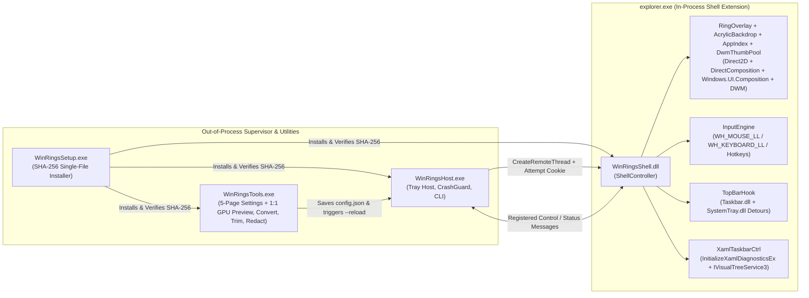

# WinRings — Native Windows 11 Radial Switcher & Unified Minimal Top Bar

[](https://github.com/AhmadotEng/WinRings)
[](https://github.com/AhmadotEng/WinRings)
[](https://github.com/AhmadotEng/WinRings)
[](https://github.com/AhmadotEng/WinRings/releases)
[](LICENSE)

**WinRings** is a **100% pure native C++17 (`x64`, static `/MT` CRT, zero `.NET`/CLR)** Windows 11 shell extension that integrates directly into `explorer.exe`. It combines two flagship capabilities into a single cohesive runtime:

1. **Radial Switcher & Gesture Engine** — An instant-opening Direct2D + DirectComposition radial app/window/file switcher with live rounded DWM window thumbnails, outer-arc submenus, `Downloads` folder fan-out with OLE drag-out, and drag-and-drop file actions (Convert, Compress/Trim, Archive, Redact).
2. **Unified Minimal Top Bar** — A zero-WinRT `Taskbar.dll` + `SystemTray.dll` native hook and live XAML Visual Diagnostics controller (`InitializeXamlDiagnosticsEx` + `IVisualTreeServiceCallback2`) that transforms the Windows 11 taskbar into a `30 DIP` clear or frosted minimal top bar (`rcWork.top = 30`), hides taskbar app/chrome clutter while preserving and compacting the live System Tray, repositions the system tray overflow flyout (`^`) directly **below** the top bar, and formats a single-line custom clock (`Fri 20 Nov  4:02 pm`) without altering the native font size.

---

## Table of Contents

- [Key Features](#key-features)
- [System Architecture](#system-architecture)
- [Quick Start & Installation](#quick-start--installation)
- [How to Trigger & Use the Ring](#how-to-trigger--use-the-ring)
- [Unified Minimal Top Bar](#unified-minimal-top-bar)
- [CLI Reference](#cli-reference)
- [Configuration (`config.json`)](#configuration-configjson)
- [Building & Testing from Source](#building--testing-from-source)
- [Documentation Index](#documentation-index)
- [Project Lineage](#project-lineage)
- [License](#license)

---

## Key Features

### 1. Radial Switcher (`RingOverlay`, `AcrylicBackdrop`, `RingThemeEngine`, `AppIndex`, `DwmThumbPool`, `InputEngine`)
- **Approved Native A4S-Menu Frosted Acrylic & 3D Beveled Glass Edges (`RingOverlay` + `RingThemeEngine`):**
  - **Exact Native A4S-Menu Backdrop:** Uses a synchronized click-through backdrop window (`WinRings.WcaBackdrop.v1`) running Windows 11's native `SetWindowCompositionAttribute(WCA_ACCENT_POLICY, ACCENT_ENABLE_ACRYLICBLURBEHIND, state = 4, flags = 0x13, 0x80202020)` with `BeginBufferedPaint(BPPF_ERASE)` and hash-gated `SetWindowRgn` (`RGN_DIFF` hollow annulus, curved outer arcs, and rounded pills) — delivering the exact same DWM acrylic texture, blur, luminosity, and glow as A4S-Menu, with automatic fallback to `Windows::UI::Composition` (`AcrylicBackdrop`).
  - **Smooth 3D Glass Bevel Rims:** Layered directly beneath the antialiased Direct2D + DirectComposition foreground overlay (`WinRings.Overlay.v1`), which bridges the `1.0 px` inset region boundary with a `2.0 DIP` antialiased edge-bridge, a subtle top-lit 3D outer glass bezel gradient, an optically recessed 3D inner bevel gradient, and a soft elevation shadow lip.
  - **3 Visual Style Presets:** **`A4S`** (default A4S-Menu live wallpaper-reactive frosted acrylic), **`DarkWood`** (matte `#202020` dark surface), and **`Blue`** (`#3186FF` sapphire glass), paired with continuous **Glass Level (`0–100%`)** and **Light / Dark Mode (`0–100%`)** sliders.
  - **True Annulus Geometry:** Clean open center ring (`holeRadius = 60 DIP`, `outerRadius = 148 DIP`, `ringRadius = 112 DIP`, `iconSize = 42 DIP`) with no shaded center disc or cone wedge overlay.
- **Frame-0 Instant Response:** Opens at full scale on frame 0 (`disableOpeningAnimation = true` by default) and respects Windows `SPI_GETCLIENTAREAANIMATION`.
- **Bounded Annulus + Cone Hit-Testing (`18 DIP` Deadzone):** Tight `18 DIP` inner deadzone (`ringDeadzoneDip = 18.0`) with strictly bounded main-ring hover detection (`dist <= outerRadius + 14 DIP`) so moving into empty outer space never triggers unexpanded slots, while active outer submenus remain reachable through their angular hover corridor.
- **System-Wide App Search & Top Half-Ring (`AppIndex` + `SearchMatch`):**
  - Type while the Ring is open in Sticky Mode to display the floating search pill with magnifying-glass icon above the Ring (`#515151` border).
  - Highlights matching pinned or running apps directly on the main ring (including pinned apps that are not currently running) and opens a **curved top half-ring** (`up to 6 system apps`) indexed from Start Menu shortcuts and `shell:AppsFolder`.
- **Live Rounded DWM Window Previews:** Pools up to 9 non-layered top-level DWM thumbnail windows (`DWMWCP_ROUND`) around the outer arc for multi-window apps, or switches to a compact `TitleColumn` list view.
- **Multi-Trigger Input & Dual Activation Modes:**
  - **Mouse Triggers:** `SideBack` (`XButton1`, default), `SideForward` (`XButton2`), `Middle`, or `Right+Left Chord`.
  - **Quick-Tap vs. Hold-Flick-Release:** Tap `< 180 ms` locks the ring open in **Sticky Mode** (click, type to search/filter, arrow keys, or press `1–9`); hold `>= 180 ms`, flick toward a slot, and release to switch immediately.
  - **Double-Tap Last App:** Double-tapping the mouse trigger within `280 ms` jumps straight to your previous foreground application (`Alt+Tab` fast toggle).
  - **Scroll-Wheel Cycling:** Scroll while the ring is open to cycle windows or slots without leaking `WM_MOUSEWHEEL` to background apps.
  - **Keyboard Triggers:** Configurable global hotkey (`Alt + Space` default), Menu key (`VK_APPS`), and optional `Win + Tab` / `Alt + Tab` shell interception.
- **Curved Outer-Arc Submenus & Drag-and-Drop Workflows:**
  - **Multi-Window Fan-Out:** Hover any running app with multiple windows to fan out live DWM previews along the outer arc; middle-click any preview to close that window (`WM_CLOSE`).
  - **Curved Half-Ring Downloads & Folder Fan-Out with OLE Drag-Out:** Hover the pinned `Downloads` folder (or any pinned Folder/Collection) to expand a continuous curved frosted acrylic half-ring showing the 9 newest files/items, and drag any item directly out into another app.
  - **Drop Target Actions:** Drag files from Explorer onto Ring slots to launch with a target app, move/copy into a folder, send to `RecycleBin`, convert images/media (`Convert`), or compress/trim/zip/redact (`Actions`).
- **5-Page Settings Suite with Persistent 1:1 GPU Preview (`WinRingsTools.exe --settings`):**
  - `1040x660` dark-mode native Win32 + Direct2D 1.1 Settings UI (**Appearance**, **Triggers & Input**, **Top Bar & Clock**, **Pins & Folders**, **Advanced**).
  - Live 1:1 GPU effect-graph preview shown across **Appearance**, **Pins & Folders**, and **Advanced** using the shared `RingThemeEngine.h`, `RadialMath.h`, frosted noise texture, real extracted shell icons, running dots, and **Split Test** / **Live Desktop** backdrop toggle.

### 2. Unified Minimal Top Bar (`TopBarHook`, `XamlTaskbarCtrl`)
- **Top-Edge Docking & Work-Area Reservation:** Docks the native Windows 11 `Shell_TrayWnd` to the top edge of the monitor (`ABE_TOP = 1`) at a compact `28–40 DIP` height (`30 DIP` default) and updates `SPI_GETWORKAREA` (`rcWork.top = 30`) so maximized windows sit cleanly beneath the bar.
- **Zero-WinRT `Taskbar.dll` & `SystemTray.dll` Hooks:**
  - Hooks `TrayUI::GetMinSize` (primary & secondary), `TrayUI::GetDockedRect`, and `GetAutoHideFlags`, driving resize/redock through `ITrayUI::VerifySize` (`vtable[0x68]`) without ever touching fragile internal WinRT XAML island edge notifications.
  - Hooks `SystemTray.dll!OverflowXamlIslandManager::PositionWindow` (`0x0B9EB0`) plus an in-process `WINEVENT_INCONTEXT` guard so clicking the system tray overflow chevron (`^`) opens `TopLevelWindowForOverflowXamlIsland` directly **below** the top taskbar (`Y = topBarBottomPx + 4 DIP`) instead of off-screen above `Y = 0`.
- **Live XAML Visual Diagnostics Controller:**
  - Attaches in-process via `InitializeXamlDiagnosticsEx` (`VisualDiagConnection1..60`) and `IVisualTreeServiceCallback2`.
  - Snapshots every original `DependencyProperty` before modification and restores 100% of native taskbar properties on disable or exit.
  - **Single-Line Compact Clock:** Replaces the two-line Windows 11 date/time stack with a single-line clock (`ddd d MMM  h:mm tt` -> `Fri 20 Nov  4:02 pm`, TitleCase weekday/month + lowercase `am`/`pm`) while keeping the native taskbar `FontSize` unchanged.
  - **Selective Chrome Hiding & System Tray Compaction:** Hides taskbar app icons (`TaskbarFrameRepeater`), Start button, Search box, Task View, and Widgets while compacting and vertically centering `SystemTrayFrame`, `NotifyIconStack`, `SystemTray.ChevronIconView`, `SystemTray.NotifyIconView`, `ControlCenterButton`, `ClockButton`, and `NotificationCenterButton`.
  - **Clear / Frosted / Native Backdrops:** Supports 100% transparent (`Clear`), dark translucent (`Frosted`), or stock Windows 11 (`Native`) backgrounds.

---

## System Architecture



| Binary | Size | Role |
| :--- | :--- | :--- |
| **`WinRingsHost.exe`** | `~280 KB` | Resident supervisor, custom cyan ring tray icon (auto-promoted in `HKCU\Control Panel\NotifyIconSettings`), Explorer injection handshake, 3-crash-in-180s safety circuit breaker, and CLI dispatcher. |
| **`WinRingsShell.dll`** | `~758 KB` | In-process Explorer module hosting `RingOverlay`, `AcrylicBackdrop`, `RingThemeEngine`, `AppIndex`, `DwmThumbPool`, `InputEngine`, `WindowTracker`, `SlotModel`, `DropTarget`, `TopBarHook`, and `XamlTaskbarCtrl`. |
| **`WinRingsTools.exe`** | `~486 KB` | Dark-mode native Win32/Direct2D 1.1/WIC 5-page Settings UI (`1040x660` with persistent 1:1 GPU Ring preview), image/media converter, media compressor/trimmer, `.zip` archiver, and interactive image Redact editor. |
| **`WinRingsSetup.exe`** | `~1.68 MB` | Self-contained per-user installer embedding all 3 binaries as `RT_RCDATA` with `BCrypt` SHA-256 verification. |

---

## Quick Start & Installation

### Option 1: Single-File Installer (Recommended)
Download **`WinRingsSetup.exe`** from the [Releases](https://github.com/AhmadotEng/WinRings/releases) page and run:

```powershell
.\WinRingsSetup.exe
```

Or install silently from PowerShell:

```powershell
.\WinRingsSetup.exe --install --silent
```

This installs the verified binaries to:
```text
%LOCALAPPDATA%\WinRings\v1.0.0.0\
  ├── WinRingsHost.exe
  ├── WinRingsShell.dll
  └── WinRingsTools.exe
```
and registers `WinRingsHost.exe` under `HKCU\Software\Microsoft\Windows\CurrentVersion\Run` (`WinRings`).

### Option 2: Windows Startup Folder Shortcut
If you prefer managing startup items via `shell:startup` (`C:\Users\<User>\AppData\Roaming\Microsoft\Windows\Start Menu\Programs\Startup`), create a shortcut **`WinRings.lnk`** pointing to:

```text
%LOCALAPPDATA%\WinRings\v1.0.0.0\WinRingsHost.exe
```

---

## How to Trigger & Use the Ring

| Trigger / Action | Default Binding | Behavior |
| :--- | :--- | :--- |
| **Quick-Tap (Sticky Mode)** | Tap **Mouse Side Back (`XButton1`)** `< 180 ms` | Opens and locks the Ring on screen. Click any slot, hover outer submenus, type to search system apps / filter slots, use Arrow keys / `1–9`, or press `Esc` to dismiss. |
| **Hold-Flick-Release** | Hold **Mouse Side Back (`XButton1`)** `>= 180 ms` | Opens the Ring at cursor; flick outside the `18 DIP` deadzone toward any slot or outer submenu item and release to activate immediately. |
| **Double-Tap Last App** | Double-tap **Mouse Side Back (`XButton1`)** `< 280 ms` | Instantly switches between your current and previous foreground window. |
| **Keyboard Hotkey** | **`Alt + Space`** | Toggles the Ring in Sticky Mode at the cursor (or monitor center if `Shift` is held). |
| **Menu Key** | **`VK_APPS`** | Toggles the Ring in Sticky Mode. |
| **Top-Bar Pill** | Click **`O` Pill** at top-left (`0, 0`) | Toggles the Ring via mouse click on the primary monitor's top bar. |
| **Tray Icon** | Left-click / Right-click **Cyan Ring Tray Icon** | Both left-click and right-click open the WinRings tray menu below the top taskbar (`Open Ring Now`, `Toggle Top Minimal Bar`, `Settings...`, `Reload Config`, `Open Config Folder`, `Exit WinRings`). |

---

## Unified Minimal Top Bar

When `topBarEnabled: true` is active in `%APPDATA%\WinRings\config.json`:

1. **Top Docking & `30 DIP` Height:** `Shell_TrayWnd` docks to `(0, 0, screenWidth, 30)` and reserves `rcWork.top = 30`.
2. **Transparent / Frosted Backdrop:** Clears `BackgroundFill`, `BackgroundStroke`, and `ScreenEdgeStroke` in the taskbar XAML visual tree (`Clear` mode) or applies a dark translucent acrylic tint (`Frosted` mode).
3. **Single-Line Clock (`Fri 20 Nov  4:02 pm`):** Collapses `DateInnerTextBlock` and formats `TimeInnerTextBlock` in-place every second using TitleCase weekday/month and lowercase `am`/`pm` (`ClockCasing::CompactLower`) without modifying `FontSize`.
4. **System Tray Overflow Below Top Bar:** Clicking the `^` hidden-icons chevron on the top bar opens the tray overflow flyout directly **under** the top taskbar (`Y = topBarBottomPx + 4 DIP`).
5. **Instant Toggle & 100% Native Restoration:** Toggle the Minimal Top Bar on or off at any time from the tray menu (`Toggle Top Minimal Bar`) or CLI (`WinRingsHost.exe --toggle-topbar`). Disabling restores the taskbar to the bottom edge at `48 DIP` with all original XAML properties intact.

---

## CLI Reference

```powershell
# Check live host & shell attachment status
& "$env:LOCALAPPDATA\WinRings\v1.0.0.0\WinRingsHost.exe" --status

# Toggle the Radial Ring overlay
& "$env:LOCALAPPDATA\WinRings\v1.0.0.0\WinRingsHost.exe" --toggle

# Toggle the Unified Minimal Top Bar on/off
& "$env:LOCALAPPDATA\WinRings\v1.0.0.0\WinRingsHost.exe" --toggle-topbar

# Open the 5-page Settings & Pins UI (with live 1:1 GPU preview)
& "$env:LOCALAPPDATA\WinRings\v1.0.0.0\WinRingsHost.exe" --settings

# Hot-reload %APPDATA%\WinRings\config.json into Explorer
& "$env:LOCALAPPDATA\WinRings\v1.0.0.0\WinRingsHost.exe" --reload

# Run the standalone Ring Preview Window (without Explorer injection)
& "$env:LOCALAPPDATA\WinRings\v1.0.0.0\WinRingsHost.exe" --preview

# Reset the 3-crash-in-180s safety circuit breaker
& "$env:LOCALAPPDATA\WinRings\v1.0.0.0\WinRingsHost.exe" --reset-safety

# Cleanly unhook, restore native taskbar state, and exit WinRings
& "$env:LOCALAPPDATA\WinRings\v1.0.0.0\WinRingsHost.exe" --exit
```

---

## Configuration (`config.json`)

WinRings stores its configuration at `%APPDATA%\WinRings\config.json` (`C:\Users\<User>\AppData\Roaming\WinRings\config.json`) and diagnostic logs at `%APPDATA%\WinRings\shell_diag.log`.

```json
{
  "version": 3,
  "mouseTrigger": "SideBack",
  "tapThresholdMs": 180,
  "doubleTapWindowMs": 280,
  "doubleTapLastApp": true,
  "scrollWheelMode": "CycleWindows",
  "hotkeyEnabled": true,
  "hotkeyModifiers": 1,
  "hotkeyVk": 32,
  "menuKeyEnabled": true,
  "interceptWinTab": false,
  "interceptAltTab": false,
  "topBarRingButton": true,
  "theme": "A4S",
  "glassLevel": 50,
  "lightDarkMode": 0,
  "accentColor": "#0078D4",
  "ringRadiusDip": 112.0,
  "ringDeadzoneDip": 18.0,
  "iconSizeDip": 42.0,
  "disableOpeningAnimation": true,
  "windowSubmenuView": "OuterArc",
  "fanOutSingleWindow": false,
  "thumbnailScale": 1.0,
  "pointerFollow": false,
  "shiftCenterOnActiveMonitor": true,
  "includeUnpinnedRunningApps": true,
  "maxSlots": 14,
  "topBarEnabled": true,
  "topBarDockTop": true,
  "topBarHeightDip": 30,
  "topBarKeepFontSize": true,
  "topBarClockSingleLine": true,
  "topBarClockFormat": "ddd d MMM  h:mm tt",
  "topBarClockCasing": "CompactLower",
  "topBarHideAppButtons": true,
  "topBarHideStart": true,
  "topBarHideSearch": true,
  "topBarHideTaskView": true,
  "topBarHideWidgets": true,
  "topBarBackdrop": "Clear",
  "topBarAllMonitors": true
}
```

---

## Building & Testing from Source

### Prerequisites
- **Windows 11 x64** (verified on Windows 11 25H2 Build `26200.8875`)
- **Visual Studio 2022 Build Tools** or Visual Studio 2022 (`MSVC v143` x64 C++ toolset + Windows 11 SDK)
- **PowerShell 5.1+**

### Build All Targets & Installer
```powershell
powershell -ExecutionPolicy Bypass -File .\tools\Build-WinRings.ps1
```
Compiles all 5 targets with `/std:c++17 /MT /O2 /EHsc /W4 /WX` (zero warnings, zero `.NET` dependencies) and stages deliverables under `build\stage\`.

### Run Automated Verification & Unit Tests
```powershell
powershell -ExecutionPolicy Bypass -File .\tools\Test-WinRingsProduct.ps1
```
Verifies x64 PE headers, zero CLR imports, DLL exports, ABI contract (`WinRingsAbiProbe.exe`), `--version` exit codes, and the unit test suite (`WinRingsTests.exe`).

---

## Documentation Index

- **[docs/ARCHITECTURE.md](docs/ARCHITECTURE.md)** — Deep-dive into the 4-binary architecture, Explorer injection protocol, Direct2D/DirectComposition rendering, DWM thumbnail pool, `Taskbar.dll` / `SystemTray.dll` zero-WinRT detours, and XAML Visual Diagnostics.
- **[docs/CONFIGURATION_AND_USAGE.md](docs/CONFIGURATION_AND_USAGE.md)** — Complete user & power-user guide covering triggers, themes, pins, collections, drag-and-drop tools, top-bar settings, clock formatting, and Startup setup.
- **[docs/BUILDING_AND_TESTING.md](docs/BUILDING_AND_TESTING.md)** — Build pipeline, verification gates, live lifecycle testing, and troubleshooting with `shell_diag.log`.
- **[docs/PRIOR_PROJECTS_SYNTHESIS.md](docs/PRIOR_PROJECTS_SYNTHESIS.md)** — Technical study of predecessor projects (`A4S-Menu` and `ClearTaskbar.exe`) and how WinRings unifies their shell integration patterns.
- **[docs/IMPLEMENTATION_PLAN.md](docs/IMPLEMENTATION_PLAN.md)** — Complete engineering specification and phase-by-phase implementation plan.
- **[docs/ENGINEERING_WALKTHROUGH.md](docs/ENGINEERING_WALKTHROUGH.md)** — Development, debugging, reverse-engineering (`Taskbar.dll` & `SystemTray.dll`), and verification walkthrough.
- **[docs/RADIAL_SWITCHER_SPEC.md](docs/RADIAL_SWITCHER_SPEC.md)** — Original radial switcher design plan and interaction specification.
- **[CHANGELOG.md](CHANGELOG.md)** — Release history and `v1.0.0` release notes.

---

## Project Lineage

WinRings builds upon lessons learned from two earlier Windows 11 shell customization projects:
- **[A4S-Menu](https://github.com/AhmadotEng/A4S-Menu)** — Native C++17 `A4SHost.exe` + `A4SShell.dll` Explorer-injected Start Menu replacement with crash-loop safety guards, cryptographic injection handshakes, and single-file SHA-256-verified installer packaging.
- **ClearTaskbar** — In-process Windows 11 XAML Visual Diagnostics (`InitializeXamlDiagnosticsEx` + `IVisualTreeServiceCallback2`) taskbar controller for transparent backdrops and single-line clock formatting.

---

## License

Licensed under the [MIT License](LICENSE). Copyright (c) 2026 Ahmad Mustafa ([AhmadotEng](https://github.com/AhmadotEng)).
