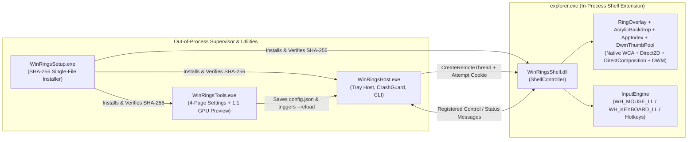

# WinRings — Native Windows 11 Radial Switcher

[](https://github.com/AhmadotEng/WinRings)
[](https://github.com/AhmadotEng/WinRings)
[](https://github.com/AhmadotEng/WinRings)
[](https://github.com/AhmadotEng/WinRings/releases)
[](LICENSE)

**WinRings** is a **100% pure native C++17 (`x64`, static `/MT` CRT, zero `.NET`/CLR)** Windows 11 Radial Switcher & Gesture Engine that integrates cleanly into `explorer.exe`. It delivers an instant-opening Direct2D + DirectComposition radial app/window/file switcher with native A4S-Menu WCA acrylic glass, smooth 3D glass bevel rims, live rounded DWM window thumbnails, outer-arc submenus, `Downloads` folder fan-out with OLE drag-out, spring-loaded hover-to-open windows, drag-to-reorder ring icons, and direct file/URL drag-and-drop.

WinRings is a pure Radial Switcher & Gesture Launcher — it never hooks Windows taskbar modules, system tray UI, or Start Menu internals, so it coexists cleanly alongside companion desktop utilities.

---

## Table of Contents

- [Key Features](#key-features)
- [System Architecture](#system-architecture)
- [Quick Start & Installation](#quick-start--installation)
- [How to Trigger & Use the Ring](#how-to-trigger--use-the-ring)
- [CLI Reference](#cli-reference)
- [Configuration (`config.json`)](#configuration-configjson)
- [Building & Testing from Source](#building--testing-from-source)
- [Documentation Index](#documentation-index)
- [License](#license)

---

## Key Features

### 1. Radial Switcher (`RingOverlay`, `AcrylicBackdrop`, `RingThemeEngine`, `AppIndex`, `DwmThumbPool`, `InputEngine`)
- **Approved Native A4S-Menu Frosted Acrylic & 3D Beveled Glass Edges (`RingOverlay` + `RingThemeEngine`):**
  - **Exact Native A4S-Menu Backdrop:** Uses a synchronized click-through backdrop window (`WinRings.WcaBackdrop.v1`) running Windows 11's native `SetWindowCompositionAttribute(WCA_ACCENT_POLICY, ACCENT_ENABLE_ACRYLICBLURBEHIND, state = 4, flags = 0x13, 0x80202020)` with `BeginBufferedPaint(BPPF_ERASE)` and hash-gated `SetWindowRgn` (`RGN_DIFF` hollow annulus, curved outer arcs, and rounded pills) — delivering the exact same DWM acrylic texture, blur, luminosity, and glow as A4S-Menu, with automatic fallback to `Windows::UI::Composition` (`AcrylicBackdrop`).
  - **Smooth 3D Glass Bevel Rims:** Layered directly beneath the antialiased Direct2D + DirectComposition foreground overlay (`WinRings.Overlay.v1`), which bridges the `1.0 px` inset region boundary with a `2.0 DIP` antialiased edge-bridge, a subtle top-lit 3D outer glass bezel gradient, an optically recessed 3D inner bevel gradient, and a soft elevation shadow lip.
  - **3 Visual Style Presets:** **`A4S`** (default A4S-Menu live wallpaper-reactive frosted acrylic), **`DarkWood`** (matte `#202020` dark surface), and **`Blue`** (`#3186FF` sapphire glass), paired with continuous **Glass Level (`0–100%`)** and **Light / Dark Mode (`0–100%`)** sliders.
  - **True Annulus Geometry:** Clean open center ring (`holeRadius = 60 DIP`, `outerRadius = 148 DIP`, `ringRadius = 112 DIP`, `iconSize = 42 DIP`) with no shaded center disc or cone wedge overlay.
- **Frame-0 Instant Response:** Opens at full scale on frame 0 (`disableOpeningAnimation = true` by default) and respects Windows `SPI_GETCLIENTAREAANIMATION`.
- **Bounded Annulus + Cone Hit-Testing (`18 DIP` Deadzone):** Tight `18 DIP` inner deadzone (`ringDeadzoneDip = 18.0`) with strictly bounded main-ring hover detection (`dist <= outerRadius + 14 DIP`) so moving into empty outer space never triggers unexpanded slots, while active outer submenus remain reachable through their angular hover corridor.
- **System-Wide App Search & Top Half-Ring (`AppIndex` + `SearchMatch`):**
  - Type while the Ring is open in Sticky Mode to display the floating search pill with magnifying-glass icon above the Ring (`#515151` border).
  - Highlights matching pinned or running apps directly on the main ring (including pinned apps that are not currently running) and opens a **curved top half-ring** (`up to 6 system apps`) indexed from Start Menu shortcuts and `shell:AppsFolder`.
- **Live Rounded DWM Window Previews:** Pools up to 9 non-layered top-level DWM thumbnail windows (`DWMWCP_ROUND`) around the outer arc for multi-window apps, or switches to a compact `TitleColumn` list view.
- **Multi-Trigger Input & Dual Activation Modes:**
  - **Mouse Triggers:** `SideBack` (`XButton1`, default), `SideForward` (`XButton2`), `Middle`, or `Right+Left Chord`.
  - **Quick-Tap vs. Hold-Flick-Release:** Tap `< 180 ms` locks the ring open in **Sticky Mode** (click, type to search/filter, arrow keys, or press `1–9`); hold `>= 180 ms`, flick toward a slot, and release to switch immediately.
  - **Double-Tap Last App:** Double-tapping the mouse trigger within `280 ms` jumps straight to your previous foreground application (`Alt+Tab` fast toggle).
  - **Scroll-Wheel Cycling:** Scroll while the ring is open to cycle windows or slots without leaking `WM_MOUSEWHEEL` to background apps.
  - **Keyboard Triggers:** Configurable global hotkey (`Alt + Space` default), Menu key (`VK_APPS`), and optional `Win + Tab` / `Alt + Tab` shell interception.
- **Curved Outer-Arc Submenus & Drag-and-Drop Workflows:**
  - **Multi-Window Fan-Out:** Hover any running app with multiple windows to fan out live DWM previews along the outer arc; middle-click any preview to close that window (`WM_CLOSE`).
  - **Curved Half-Ring Downloads & Folder Fan-Out with OLE Drag-Out:** Hover the pinned `Downloads` folder (or any pinned Folder/Collection) to expand a continuous curved frosted acrylic half-ring showing the 9 newest files/items, and drag any item directly out into another app or onto another ring icon (the ring stays open so you can continue the drag).
  - **Interactive Drag-and-Drop Workflows:**
    - **Click-vs-Drag Differentiated:** Clicking outside dismisses only on a clean click (never when dragging a file toward the ring), and summoning the ring while holding a dragged file automatically locks the ring open.
    - **Center Pinning:** Drop any file, folder, `.exe`, or `http(s)://` URL into the ring center (`Pin to Ring`) to pin it immediately.
    - **Direct Slot Drop:** Drop files onto an **App/Script** to launch with those files, onto a **Folder** (e.g., `Downloads`) to copy into it cleanly, or onto **Recycle Bin** to delete.
    - **Spring-Loaded Window Switching:** Hold a dragged file over any **App** or **Folder** icon for ~0.5s — the icon plays a double-heartbeat scale animation and brings that app/folder window to the front while you keep holding the file so you can drop it right inside.
    - **Drag Icons to Reorder:** Press and drag any pinned icon around the ring to reorder pinned slots live and persist to `config.json`.
- **4-Page Settings Suite with Persistent 1:1 GPU Preview (`WinRingsTools.exe --settings`):**
  - `1040x660` dark-mode native Win32 + Direct2D 1.1 Settings UI (**Appearance**, **Triggers & Input**, **Pins & Folders**, **Advanced**).
  - Live 1:1 GPU effect-graph preview shown across **Appearance**, **Pins & Folders**, and **Advanced** using the shared `RingThemeEngine.h`, `RadialMath.h`, frosted noise texture, real extracted shell icons, running dots, and **Split Test** / **Live Desktop** backdrop toggle.

---

## System Architecture



| Binary | Size | Role |
| :--- | :--- | :--- |
| **`WinRingsHost.exe`** | `~207 KB` | Resident supervisor, custom cyan ring tray icon (auto-promoted in `HKCU\Control Panel\NotifyIconSettings`), Explorer injection handshake, 3-crash-in-180s safety circuit breaker, and CLI dispatcher. |
| **`WinRingsShell.dll`** | `~661 KB` | In-process Explorer module hosting `RingOverlay`, `AcrylicBackdrop`, `RingThemeEngine`, `AppIndex`, `DwmThumbPool`, `InputEngine`, `WindowTracker`, `SlotModel`, and `DropTarget`. Zero taskbar or XAML hooks. |
| **`WinRingsTools.exe`** | `~396 KB` | Dark-mode native Win32/Direct2D 1.1/WIC 4-page Settings UI (`1040x660` with persistent 1:1 GPU Ring preview). |
| **`WinRingsSetup.exe`** | `~1.42 MB` | Self-contained per-user installer embedding all 3 binaries as `RT_RCDATA` with `BCrypt` SHA-256 verification. |

---

## Quick Start & Installation

### Option 1: Single-File Installer (Recommended)
Download **`WinRingsSetup.exe`** from the [Releases](https://github.com/AhmadotEng/WinRings/releases) page and run:

```powershell
.\WinRingsSetup.exe
```

Or install silently from PowerShell:

```powershell
.\WinRingsSetup.exe --install --silent
```

This installs the verified binaries to:
```text
%LOCALAPPDATA%\WinRings\v1.0.0.0\
  ├── WinRingsHost.exe
  ├── WinRingsShell.dll
  └── WinRingsTools.exe
```
and registers `WinRingsHost.exe` under `HKCU\Software\Microsoft\Windows\CurrentVersion\Run` (`WinRings`).

### Option 2: Windows Startup Folder Shortcut
If you prefer managing startup items via `shell:startup` (`C:\Users\<User>\AppData\Roaming\Microsoft\Windows\Start Menu\Programs\Startup`), create a shortcut **`WinRings.lnk`** pointing to:

```text
%LOCALAPPDATA%\WinRings\v1.0.0.0\WinRingsHost.exe
```

---

## How to Trigger & Use the Ring

| Trigger / Action | Default Binding | Behavior |
| :--- | :--- | :--- |
| **Quick-Tap (Sticky Mode)** | Tap **Mouse Side Back (`XButton1`)** `< 180 ms` | Opens and locks the Ring on screen. Click any slot, hover outer submenus, type to search system apps / filter slots, use Arrow keys / `1–9`, or press `Esc` to dismiss. |
| **Hold-Flick-Release** | Hold **Mouse Side Back (`XButton1`)** `>= 180 ms` | Opens the Ring at cursor; flick outside the `18 DIP` deadzone toward any slot or outer submenu item and release to activate immediately. |
| **Double-Tap Last App** | Double-tap **Mouse Side Back (`XButton1`)** `< 280 ms` | Instantly switches between your current and previous foreground window. |
| **Keyboard Hotkey** | **`Alt + Space`** | Toggles the Ring in Sticky Mode at the cursor (or monitor center if `Shift` is held). |
| **Menu Key** | **`VK_APPS`** | Toggles the Ring in Sticky Mode. |
| **Tray Icon** | Left-click / Right-click **Cyan Ring Tray Icon** | Both left-click and right-click open the WinRings tray menu (`Open Ring Now`, `Settings...`, `Reload Config`, `Open Config Folder`, `Exit WinRings`). |

---

## CLI Reference

```powershell
# Check live host & shell status
& "$env:LOCALAPPDATA\WinRings\v1.0.0.0\WinRingsHost.exe" --status

# Toggle the Radial Ring overlay
& "$env:LOCALAPPDATA\WinRings\v1.0.0.0\WinRingsHost.exe" --toggle

# Open the 4-page Settings & Pins UI (with live 1:1 GPU preview)
& "$env:LOCALAPPDATA\WinRings\v1.0.0.0\WinRingsHost.exe" --settings

# Hot-reload %APPDATA%\WinRings\config.json into Explorer
& "$env:LOCALAPPDATA\WinRings\v1.0.0.0\WinRingsHost.exe" --reload

# Run the standalone Ring Preview Window (without Explorer injection)
& "$env:LOCALAPPDATA\WinRings\v1.0.0.0\WinRingsHost.exe" --preview

# Reset the 3-crash-in-180s safety circuit breaker
& "$env:LOCALAPPDATA\WinRings\v1.0.0.0\WinRingsHost.exe" --reset-safety

# Cleanly disarm and exit WinRings
& "$env:LOCALAPPDATA\WinRings\v1.0.0.0\WinRingsHost.exe" --exit
```

---

## Configuration (`config.json`)

WinRings stores its configuration at `%APPDATA%\WinRings\config.json` (`C:\Users\<User>\AppData\Roaming\WinRings\config.json`) and diagnostic logs at `%APPDATA%\WinRings\shell_diag.log`.

```json
{
  "version": 3,
  "mouseTrigger": "SideBack",
  "tapThresholdMs": 180,
  "doubleTapWindowMs": 280,
  "doubleTapLastApp": true,
  "scrollWheelMode": "CycleSlotsOrWindows",
  "hotkeyEnabled": true,
  "hotkeyModifiers": 1,
  "hotkeyVk": 32,
  "menuKeyEnabled": false,
  "interceptWinTab": false,
  "interceptAltTab": false,
  "theme": "A4S",
  "glassLevel": 50,
  "lightDarkMode": 0,
  "accentColor": "#0078D4",
  "ringRadiusDip": 115.0,
  "deadzoneDip": 18.0,
  "iconSizeDip": 44.0,
  "disableOpeningAnimation": true,
  "windowViewMode": "OuterArc",
  "fanOutSingleWindow": true,
  "thumbnailScale": 1.0,
  "pointerFollow": true,
  "shiftCenterOnActiveMonitor": true,
  "includeUnpinnedRunningApps": true,
  "maxSlots": 14
}
```

---

## Building & Testing from Source

### Prerequisites
- **Windows 11 x64** (verified on Windows 11 25H2 Build `26200.8875`)
- **Visual Studio 2022 Build Tools** or Visual Studio 2022 (`MSVC v143` x64 C++ toolset + Windows 11 SDK)
- **PowerShell 5.1+**

### Build All Targets & Installer
```powershell
powershell -ExecutionPolicy Bypass -File .\tools\Build-WinRings.ps1
```
Compiles all 5 targets with `/std:c++17 /MT /O2 /EHsc /W4 /WX` (zero warnings, zero `.NET` dependencies) and stages deliverables under `build\stage\`.

### Run Automated Verification & Unit Tests
```powershell
powershell -ExecutionPolicy Bypass -File .\tools\Test-WinRingsProduct.ps1
```
Verifies x64 PE headers, zero CLR imports, DLL exports, ABI contract (`WinRingsAbiProbe.exe`), `--version` exit codes, and the unit test suite (`WinRingsTests.exe`).

---

## Documentation Index

- **[AGENTS.md](AGENTS.md)** — Primary engineering guide, development invariants, verification loop, and context pointers for new contributors & AI agents.
- **[docs/ARCHITECTURE.md](docs/ARCHITECTURE.md)** — Four-binary architecture, Explorer injection & IPC/ABI contract, module inventory, and data flows.
- **[docs/VISUAL_SYSTEM.md](docs/VISUAL_SYSTEM.md)** — Dual-HWND native WCA acrylic pipeline, `1.0 px`-inset region clipping, 3D glass bezels, `RingThemeEngine.h` presets/sliders, and `dwmcore`/Direct2D 1.1 calibration.
- **[docs/INTERACTION_AND_MATH.md](docs/INTERACTION_AND_MATH.md)** — `InputEngine` triggers, click-vs-drag, `RadialMath.h` corridors/arcs, drag-and-drop workflows, spring-loading, reorder math, and 4-tier search.
- **[docs/BUILDING_AND_TESTING.md](docs/BUILDING_AND_TESTING.md)** — MSVC x64 build pipeline, 5 verification gates, safe `--preview`/`--settings` testing, and `shell_diag.log` diagnostics.
- **[docs/ROADMAP_AND_IDEAS.md](docs/ROADMAP_AND_IDEAS.md)** — Feature ideas, UX polish opportunities, modularity refactors, and scope guardrails for WinRings v3.1+.
- **[CHANGELOG.md](CHANGELOG.md)** — Full release history (`v1.0.0` through `v3.0.0`).

---

## License

Licensed under the [MIT License](LICENSE). Copyright (c) 2026 Ahmad Mustafa ([AhmadotEng](https://github.com/AhmadotEng)).
