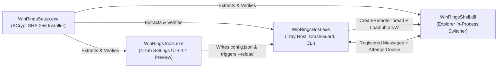

# WinRings — System Architecture & Module Reference (v3.0.0)

WinRings is a four-binary native C++17 (`x64`, static `/MT` CRT, zero `.NET`/CLR) application integrating cleanly into Windows 11 `explorer.exe` while isolating configuration UI and installation lifecycle into dedicated executables.

---

## 1. Binary Decomposition & Process Model

### Why Separate Binaries?
1. **Lean `explorer.exe` footprint:** Direct2D 1.1 UI forms, file browsers, and the persistent settings GPU preview stay out-of-process in `WinRingsTools.exe`.
2. **Crash-loop safety (`CrashGuard`):** `WinRingsHost.exe` monitors `explorer.exe` via `MsgWaitForMultipleObjectsEx`. If `explorer.exe` exits abnormally **3 times within 180 seconds** (`kCrashLoopThreshold = 3`, `kCrashLoopWindow100ns` in `src/shared/CrashGuard.h`), `WinRingsHost.exe` writes `InjectionDisabled = 1` under `HKCU\Software\WinRings\HostSafety` and halts future injection until `--reset-safety`.
3. **Resilient recovery:** Receiving `TaskbarCreated` re-registers the promoted cyan ring tray icon (`HKCU\Control Panel\NotifyIconSettings`) and re-injects `WinRingsShell.dll`.

---

## 2. Explorer Injection, IPC & ABI Contract

Defined in `src/shared/WinRingsIdentity.h` and `src/shared/WinRingsApi.h`:

- **Target validation (`WinRingsHost.cpp`):** Verifies `Shell_TrayWnd`/`Progman` belongs to `%SystemRoot%\explorer.exe` in the same session, same user SID, and x64 architecture.
- **Cryptographic attempt cookie:** Generated via `SystemFunction036` (`RtlGenRandom`) and stored on `WinRings.Host.Window.v1` property `WinRings.Host.AttemptCookie.v1`.
- **Reattach support:** If the exact `WinRingsShell.dll` path is already loaded in `explorer.exe`, `WinRingsHost` sends `WINRINGS_CMD_REATTACH` rather than loading a second instance.
- **Lock / RDP / UAC suppression:** `WinRingsHost.cpp` uses `WTSRegisterSessionNotification` + `EVENT_SYSTEM_DESKTOPSWITCH` to send `WINRINGS_CMD_SUSPEND_INPUT` on lock/RDP/secure desktop transitions and `WINRINGS_CMD_REFRESH_INPUT` on unlock.

### Registered Messages & Commands
- **Host Control (`WinRings.Host.Control.v1`):** `TOGGLE (1)`, `EXIT (2)`, `STATUS (3)`, `RELOAD (4)`, `RESET_SAFETY (5)`, `QUERY_DETAILS (7)`.
- **Shell Command (`WinRings.Shell.Command.v1`):** `TOGGLE_RING (1)`, `EXIT (2)`, `SUSPEND_INPUT (3)`, `REFRESH_INPUT (4)`, `RELOAD_CONFIG (5)`, `QUERY_SHELL_STATE (7)` (`WINRINGS_STATE_RING_READY = 1 << 0`), `REATTACH (0xFFFF)`.
- **Shell Status (`WinRings.Shell.Status.v1`):** `READY (1)`, `FAILED (2)`, `DISARMED (3)`.
- **Exports (`src/shell/WinRingsShell.def`):** Exclusively `WinRings_GetApi` (`WINRINGS_ABI_VERSION = 0x00010000`) and `WinRings_RunPreview` (used by `--preview` outside `explorer.exe`). Zero COM class factory exports, zero taskbar/XAML hooks.

---

## 3. Complete Module Inventory

### `src/shared/` — Header-Only Pure Logic & Shared Config
| File | Lines | Responsibility |
| :--- | :---: | :--- |
| `WinRingsIdentity.h` | 38 | Product strings, mutexes, window classes, message names, version constants |
| `WinRingsApi.h` | 87 | Host/Shell command enums, status enums, C ABI (`WinRingsApi`, `WinRings_GetApi`, `WinRings_RunPreview`) |
| `WinRingsConfig.h` / `.cpp` | 115 / 849 | Config v3 schema (`SwitcherConfig`, `PinnedSlotConfig`), custom JSON parser/writer (`%APPDATA%\WinRings\config.json`), default Explorer/Downloads/Recycle Bin pins |
| `RadialMath.h` | 668 | Polar sectors (`CalculateSectorIndex`), `ComputeRingGeometry`, `ComputeIconArcLayout`, `ComputeWindowOuterArcRects`, `ComputeTitleColumnRects`, `ResolveRingHover`, `IsPointInOuterSubmenuZone`, `IsPointInHoverCorridor`, clamping/easing |
| `RingThemeEngine.h` | 292 | Presets (`A4S`, `DarkWood`, `Blue`), `glassLevel`/`lightDarkMode` curves, `RingMaterialSpec`, `GenerateAcrylicNoiseBgra256()` |
| `SlotMatching.h` | 161 | Explorer EXE check, window PiP gating (`ShouldShowSlotWindowPreview`), `ExplorerWindowMatchesFolder` / `RecycleBin`, `EvaluateSpringHover`, `ComputeReorderTargetSlotIndex`, `ReorderVectorElement` |
| `SearchMatch.h` | 127 | 4-tier query matcher (`ScoreSearchMatch`, `ScoreAliases`: Prefix/Word/Acronym/Substring) |
| `CrashGuard.h` | 71 | Rolling 3-exits-in-180s crash-loop safety state machine (`AdvanceCrashGuard`) |

### `src/shell/` — In-Process Explorer Module (`WinRingsShell.dll`)
| File | Lines | Responsibility |
| :--- | :---: | :--- |
| `DllMain.cpp` | 57 | Pins DLL module, exports `WinRings_GetApi` & `WinRings_RunPreview`, kicks off `ShellController` |
| `ShellController.h/.cpp` | 17 / 634 | Message-only control HWND (`WinRings.Shell.Control.v1`), host watchdog, coordinates `WindowTracker`, `AppIndex`, `SlotModel`, `InputEngine`, `RingOverlay`, preview runner |
| `RingOverlay.h/.cpp` | 243 / 3146 | Dual-HWND backdrop+foreground window host, Direct3D11/Direct2D1/DirectComposition renderer, WCA region/material sync, hit-testing, outer-arc & search submenus, context menu, drag-reorder, spring-load pulse, file/URL drop handling *(primary modularization candidate)* |
| `AcrylicBackdrop.h/.cpp` | 69 / 521 | Fallback `Windows::UI::Composition` `HostBackdropBrush` + strict-tree `dwmcore` D2D1 effect graph |
| `DwmThumbPool.h/.cpp` | 65 / 205 | Pre-allocated pool of 9 non-layered rounded (`DWMWCP_ROUND`) `HWND`s (`WinRings.ThumbCard.v1`) for `DwmRegisterThumbnail` live window previews |
| `InputEngine.h/.cpp` | 80 / 453 | `WH_MOUSE_LL` + `WH_KEYBOARD_LL` triggers, tap vs hold vs double-tap, chord trigger, clean click-vs-drag outside-dismiss, wheel interception, type-to-search key routing |
| `DropTarget.h/.cpp` | 45 / 164 | COM `IDropTarget` for ring drops + `IDropSource`/`SHDoDragDrop` (`StartFileDragOut`) for dragging files out of Downloads/Folder arcs |
| `WindowTracker.h/.cpp` | 95 / 608 | `EVENT_SYSTEM_FOREGROUND` WinEvent + shell hook MRU list, icon extraction/caching (preserving native `File Explorer` icon), `ActivateWindow` + cancellable 160 ms pointer glide |
| `SlotModel.h/.cpp` | 68 / 654 | Merges `pinnedSlots` with live `AppWindowGroup`s, enumerates newest Downloads/Folder files, launches apps/URLs, `FO_COPY` folder drops, Recycle Bin ops, cookie-free WinHTTP favicon downloader (`%APPDATA%\WinRings\icons\`) |
| `AppIndex.h/.cpp` | 71 / 639 | Background Start Menu `.lnk` + `shell:AppsFolder` indexer, PE friendly-name lookup (`ResolveExecutableFriendlyName`, explicitly skipped for `explorer.exe`), search query executor |

### `src/host/`, `src/tools/`, `src/setup/`
| File | Lines | Responsibility |
| :--- | :---: | :--- |
| `src/host/WinRingsHost.cpp` | 1889 | Single-instance host, Explorer injection loop, `CrashGuard` Registry persistence, WTS session watch, tray icon + menu, CLI forwarder |
| `src/tools/WinRingsTools.cpp` | 45 | Entry point parsing `--settings` / `--version` |
| `src/tools/SettingsDialog.cpp` | 2577 | `1040x660` 4-page dark Fluent Win32 + Direct2D Settings suite with persistent 1:1 GPU ring preview *(secondary modularization candidate)* |
| `src/setup/WinRingsSetup.cpp` | 589 | Single-file installer (`RT_RCDATA` resources verified with `BCrypt` SHA-256), installs to `%LOCALAPPDATA%\WinRings\v1.0.0.0\`, Run/Uninstall/Start Menu registration |

---

## 4. Runtime Data Flows & Boundary Guarantee

- **Opening & Slot Assembly:** On trigger (`InputEngine`), `ShellController` asks `SlotModel::BuildRingSlots()` to merge configured `pinnedSlots` with live `WindowTracker::EnumerateGroupedWindows()`.
  - Each `PinnedSlotConfig` resolves its matching `AppWindowGroup` windows (or `ExplorerWindowMatchesFolder` / `RecycleBin` for pinned folders/Trash) and marks `isFrontmost` for the active window's slot.
  - Remaining open apps (if `includeUnpinnedRunningApps`) append up to `maxSlots` (`14` default).
- **Config Reload Flow:** `SettingsDialog` saves `%APPDATA%\WinRings\config.json` and launches `WinRingsHost.exe --reload` -> sends `WINRINGS_HOST_CTRL_RELOAD` -> forwards `WINRINGS_CMD_RELOAD_CONFIG` to `ShellController` inside `explorer.exe` -> hot-reloads `InputEngine`, `RingOverlay`, and `AppIndex`.
- **Independent Companion Boundary:** WinRings never hooks `Taskbar.dll`, `SystemTray.dll`, or XAML visual diagnostics, leaving taskbar and Start Menu customization strictly to separate host processes.
