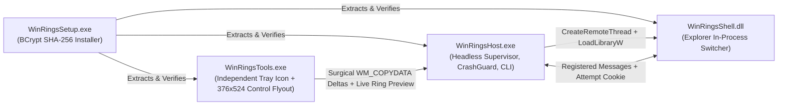

# WinRings — System Architecture & Module Reference (v3.1)

WinRings is a four-binary native C++17 (`x64`, static `/MT` CRT, zero `.NET`/CLR) application integrating cleanly into Windows 11 `explorer.exe` while keeping the headless ring supervisor (`WinRingsHost.exe`), independent Tray Control Flyout (`WinRingsTools.exe`), and installer (`WinRingsSetup.exe`) cleanly decoupled.

---

## 1. Binary Decomposition & Process Model

### Why Separate Binaries?
1. **Headless `WinRingsHost.exe` + Independent `WinRingsTools.exe` Tray:** `WinRingsHost.exe` runs silently with zero UI or tray footprint in its own process, and automatically ensures `WinRingsTools.exe --tray` is started on normal launch (pass `--no-tray` for headless/automated runs). `WinRingsTools.exe` (`--tray` / `--open` / `--quit`) owns the system tray icon and on-demand `376x544 DIP` Direct2D Control Flyout (`Triggers`, `Profiles`, `Search`, `Look`) positioned above the taskbar, destroying its flyout `HWND` and all D3D/D2D COM handles when closed and quitting cleanly (`--quit`) without disturbing the Ring engine.
2. **Crash-loop safety (`CrashGuard`):** `WinRingsHost.exe` monitors `explorer.exe` via `MsgWaitForMultipleObjectsEx`. If `explorer.exe` exits abnormally **3 times within 180 seconds** (`kCrashLoopThreshold = 3`, `kCrashLoopWindow100ns` in `src/shared/CrashGuard.h`), `WinRingsHost.exe` writes `InjectionDisabled = 1` under `HKCU\Software\WinRings\HostSafety` and halts future injection until `--reset-safety`.
3. **Resilient recovery:** Receiving `TaskbarCreated` re-injects `WinRingsShell.dll` automatically if `explorer.exe` restarted, while `WinRingsTools.exe` re-registers its cyan ring tray icon independently.

---

## 2. Explorer Injection, Surgical Delta IPC & ABI Contract

Defined in `src/shared/WinRingsIdentity.h`, `src/shared/WinRingsApi.h`, and `src/shared/WinRingsDeltaIpc.h`:

- **Target validation (`WinRingsHost.cpp`):** Verifies `Shell_TrayWnd`/`Progman` belongs to `%SystemRoot%\explorer.exe` in the same session, same user SID, and x64 architecture.
- **Cryptographic attempt cookie:** Generated via `SystemFunction036` (`RtlGenRandom`) and stored on `WinRings.Host.Window.v1` property `WinRings.Host.AttemptCookie.v1`.
- **Reattach support:** If the exact `WinRingsShell.dll` path is already loaded in `explorer.exe`, `WinRingsHost` sends `WINRINGS_CMD_REATTACH` rather than loading a second instance.
- **Lock / RDP / UAC suppression:** `WinRingsHost.cpp` uses `WTSRegisterSessionNotification` + `EVENT_SYSTEM_DESKTOPSWITCH` to send `WINRINGS_CMD_SUSPEND_INPUT` on lock/RDP/secure desktop transitions and `WINRINGS_CMD_REFRESH_INPUT` on unlock (preserving user pause state).
- **Surgical `WM_COPYDATA` Delta IPC (`WINRINGS_COPYDATA_DELTA_V1`):** `WinRingsTools.exe` sends `WinRingsDeltaPacket` (`SetLook`, `SetGestures`, `SetTriggers`, `PreviewLiveRing`, `FlushSaveToDisk`, `SetRingPaused`) directly through `WinRingsHost.exe` (or `WinRings.Preview.Control.v1` in `--preview`) to `ShellController` in memory—zero `config.json` re-parsing per slider/color/shortcut change; atomic save runs once when the Flyout closes.

### Registered Messages & Commands
- **Host Control (`WinRings.Host.Control.v1`):** `TOGGLE (1)`, `EXIT (2)`, `STATUS (3)`, `RELOAD (4)`, `RESET_SAFETY (5)`, `QUERY_DETAILS (7)`, `SET_PAUSED (8)`.
- **Shell Command (`WinRings.Shell.Command.v1`):** `TOGGLE_RING (1)`, `EXIT (2)`, `SUSPEND_INPUT (3)`, `REFRESH_INPUT (4)`, `RELOAD_CONFIG (5)`, `QUERY_SHELL_STATE (7)` (`WINRINGS_STATE_RING_READY = 1 << 0`, `WINRINGS_STATE_RING_PAUSED = 1 << 1`), `REATTACH (0xFFFF)`.
- **Tray Wake (`WinRings.Tray.Wake.v1`):** `1` open Flyout, `2` quit Tray process (`--quit`).
- **Shell Status (`WinRings.Shell.Status.v1`):** `READY (1)`, `FAILED (2)`, `DISARMED (3)`.
- **Exports (`src/shell/WinRingsShell.def`):** Exclusively `WinRings_GetApi` (`WINRINGS_ABI_VERSION = 0x00010000`) and `WinRings_RunPreview` (used by `--preview` outside `explorer.exe`). Zero COM class factory exports, zero taskbar/XAML hooks.

---

## 3. Complete Module Inventory

### `src/shared/` — Header-Only Pure Logic & Shared Config
| File | Responsibility |
| :--- | :--- |
| `WinRingsIdentity.h` | Product strings, mutexes (`Host`, `Tray`, `Setup`), window classes, message names, version constants |
| `WinRingsApi.h` | Host/Shell command enums, status/pause bits, C ABI (`WinRingsApi`, `WinRings_GetApi`, `WinRings_RunPreview`) |
| `WinRingsDeltaIpc.h` | POD `WinRingsDeltaPacket` (`WM_COPYDATA`), `ApplyDeltaToConfig`, registry System Light/Dark & Accent resolvers |
| `TriggerModel.h` | Unified `TriggerBinding` (`MouseButton`, `RightLeftChord`, `KeyChord`, `SoloModifier`, `profileId`), key formatting, conflict analyzer |
| `WinRingsConfig.h` / `.cpp` | Config v6 schema (`SwitcherConfig`, `RingProfileConfig` standalone per-profile files under `%APPDATA%\WinRings\profiles\<id>.json` with `PinnedSlotConfig::hiddenFromRing` for search-only pins, one-time legacy `search.json` migration into `default`, `SMenu` factory, `SurfaceTexture`, `triggers`, `PinnedSlotConfig`), v1–v5 auto-migration, atomic JSON reader/writer (`%APPDATA%\WinRings\config.json`) |
| `RadialMath.h` | Polar sectors (`CalculateSectorIndex`), `ComputeRingGeometry`, `ComputeIconArcLayout`, `ComputeWindowOuterArcRects`, `ComputeTitleColumnRects`, `ResolveRingHover`, `IsPointInOuterSubmenuZone`, `IsPointInHoverCorridor`, safe pointer-glide math (`ResolveRestoredWindowRect`, `ComputeSafePointerGlideTarget`, `IsUserPointerOverride`), clamping/easing |
| `RingThemeEngine.h` | Decoupled `SurfaceTexture` (`A4SAcrylic`, `TaskbarGlass`, `PureMatte`) + arbitrary surface/accent colors, `glassLevel`/`lightDarkMode` curves, 3D bezel & edge-bridge tokens, `GenerateAcrylicNoiseBgra256()` |
| `SlotMatching.h` | Explorer EXE check, window PiP gating (`ShouldShowSlotWindowPreview`), `ExplorerWindowMatchesFolder` / `RecycleBin`, `EvaluateSpringHover`, `ComputeReorderTargetSlotIndex`, `ReorderVectorElement`, `MapVisiblePinnedIndexToConfigIndex`, `MapVisiblePinnedInsertPosToConfigIndex`, `ShouldKeepSearchSelectionOnPointer` |
| `SearchMatch.h` | 4-tier query matcher (`ScoreSearchMatch`, `ScoreAliases`: Prefix/Word/Acronym/Substring), alias extraction (`BuildBasicSearchAliases`), canonical key normalization (`CanonicalSearchKey`), and source-priority ranking (`CompareSearchRankKey`) |
| `CrashGuard.h` | Rolling 3-exits-in-180s crash-loop safety state machine (`AdvanceCrashGuard`) |

### `src/shell/` — In-Process Explorer Module (`WinRingsShell.dll`)
| File | Responsibility |
| :--- | :--- |
| `DllMain.cpp` | Pins DLL module, exports `WinRings_GetApi` & `WinRings_RunPreview`, kicks off `ShellController` |
| `ShellController.h/.cpp` | Message-only control HWND (`WinRings.Shell.Control.v1` / `WinRings.Preview.Control.v1`), `WM_COPYDATA` delta handler, host watchdog, coordinates `WindowTracker`, `AppIndex`, `SlotModel`, `InputEngine`, `RingOverlay` |
| `RingOverlay.h/.cpp` + `ContextFlyout.h/.cpp` | Runtime backdrop switcher (`WcaDualHwnd` / `TaskbarComposition` / `MatteDComp`), Direct3D11/Direct2D1/DirectComposition renderer, single-instance Direct2D taskbar-style right-click popup (`End task`, `Close window`, `Run as administrator`, `Hide from ring`), hit-testing, outer-arc & search submenus, drag-reorder, spring-load pulse, file/URL drop handling |
| `AcrylicBackdrop.h/.cpp` | `Windows::UI::Composition` `HostBackdropBrush` + strict-tree `dwmcore` D2D1 effect graph powering `TaskbarGlass` |
| `DwmThumbPool.h/.cpp` | Pre-allocated pool of 9 non-layered rounded (`DWMWCP_ROUND`) `HWND`s (`WinRings.ThumbCard.v1`) for `DwmRegisterThumbnail` live window previews |
| `InputEngine.h/.cpp` | `WH_MOUSE_LL` + `WH_KEYBOARD_LL` unified `TriggerBinding` evaluator, solo `Win`/`Alt` clean tap with `0xE8` mask tap, `Alt+Tab`/`Win+Tab` chord stepping, gesture toggles, clean click-vs-drag outside-dismiss, wheel interception, type-to-search |
| `DropTarget.h/.cpp` | COM `IDropTarget` for ring drops + `IDropSource`/`SHDoDragDrop` (`StartFileDragOut`) for dragging files out of Downloads/Folder arcs |
| `WindowTracker.h/.cpp` | `EVENT_SYSTEM_FOREGROUND` WinEvent + shell hook MRU list, icon extraction/caching (preserving native `File Explorer` icon), `ActivateWindow` + cancellable 160 ms pointer glide |
| `SlotModel.h/.cpp` | Merges `pinnedSlots` with live `AppWindowGroup`s, custom `iconCacheFile` override loading, newest Downloads/Folder files, launches apps/URLs, `FO_COPY` folder drops, Recycle Bin ops, cookie-free WinHTTP favicon downloader (`%APPDATA%\WinRings\icons\`) |
| `AppIndex.h/.cpp` | Background Start Menu `.lnk` + `shell:AppsFolder` indexer, PE friendly-name lookup, search query executor |

### `src/host/`, `src/tools/`, `src/setup/`
| File | Responsibility |
| :--- | :--- |
| `src/host/WinRingsHost.cpp` | Headless single-instance supervisor, Explorer injection loop, `CrashGuard` Registry persistence, WTS session watch, `WM_COPYDATA` delta bridge, CLI forwarder |
| `src/tools/WinRingsTools.cpp` | Entry point parsing `--tray`, `--open`, `--quit`, `--version`, single-instance tray wake |
| `src/tools/TrayApp.h/.cpp` | Resident cyan tray icon + on-demand `376x544 DIP` Direct2D Control Flyout (`Triggers`, `Profiles`, `Look`) cleared above the taskbar, inline Direct2D link/command/profile/pin-edit forms (including `Hide from Ring (Search Only)`), temporary live shortcut recorder, real side-by-side Ring preview, zero-handle idle close |
| `src/setup/WinRingsSetup.cpp` | Single-file installer (`RT_RCDATA` payloads verified with `BCrypt` SHA-256), installs to `%LOCALAPPDATA%\WinRings\v1.0.0.0\`, registers both `WinRings` (Host) and `WinRingsTray` (`--tray`) Run keys + Start Menu shortcut |

---

## 4. Runtime Data Flows & Boundary Guarantee

- **Opening & Slot Assembly:** On trigger (`InputEngine`), `ShellController` asks `SlotModel::BuildRingSlots()` to merge configured `pinnedSlots` with live `WindowTracker::EnumerateGroupedWindows()` up to `maxSlots`.
- **Live Tray Sync Flow:** Clicking the Tray Icon opens `WinRings.TrayFlyout.v1` from `%APPDATA%\WinRings\config.json` and `profiles\*.json` (picking up any Ring-side pin/reorder/admin/hide edits). Switching to **Look** or **Profiles** sends `DeltaOp::PreviewLiveRing(1)` to show the real `RingOverlay` side-by-side; slider, texture, color, or shortcut changes send `WINRINGS_COPYDATA_DELTA_V1` packets straight into `ShellController`'s memory; clicking `Open "<Name>" on Ring` sends `MakeOpenProfileForEditDelta` (`intParam = 2`) so the Ring stays open for direct drag-and-drop editing even after the Flyout closes; inline pin edits (`Hide from Ring (Search Only)`, rename, custom icon, Run as Administrator) or right-clicking Ring items (`Hide from ring (search only)`) trigger immediate disk reload (`MakeReloadFromDiskDelta`); closing the Flyout sends `FlushSaveToDisk` once and releases all Flyout COM/HWND handles.
- **Independent Companion Boundary:** WinRings never hooks `Taskbar.dll`, `SystemTray.dll`, or XAML visual diagnostics, leaving taskbar and Start Menu customization strictly to separate host processes.
