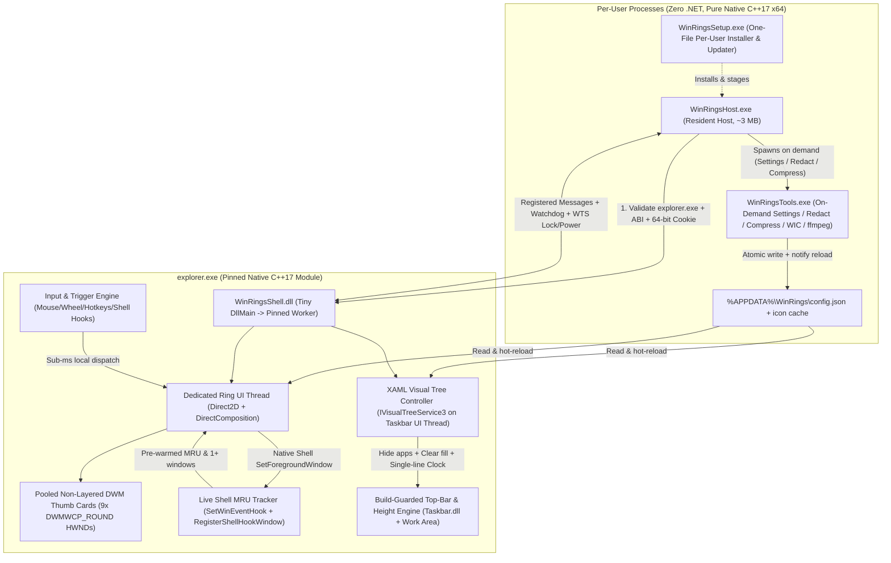

# WinRings — Implementation Plan (Pure Native C++17 x64)

## Goal Description

Build **WinRings**, a **100% pure native C++17 (x64, zero `.NET`)** shell-integrated desktop environment for Windows 11 (`25H2 build 26200.8875+`) in `C:\Users\Administrator\Documents\WinRings\WinRings` (keeping `Default Project`, `startmenu`, and `taskbar` untouched as read-only references).

WinRings unifies two tightly integrated capabilities inside `explorer.exe`:

1. **Cursor-Centered Radial Switcher ("The Ring")** — Upgrades every phase of [windows-radial-switcher-plan.md](file:///C:/Users/Administrator/Documents/WinRings/Default%20Project/Default%20Project/windows-radial-switcher-plan.md) and the Beckon radial ergonomics ([UI_ARCHITECTURE.md](file:///C:/Users/Administrator/Documents/WinRings/Default%20Project/Default%20Project/BeckonTrackpadGesture/UI_ARCHITECTURE.md)) into a sub-millisecond, GPU-composited **Direct2D + DirectComposition** shell HUD inside `explorer.exe` with pooled non-layered **DWM live window thumbnails**, **18 DIP radial cone hit-testing**, **frame-0 instant static mode**, exhaustive configurable triggers (mouse buttons, scroll wheel, double-tap last app, `Alt+Space`, `VK_APPS`, optional `Win+Tab`/`Alt+Tab`, top-bar trigger), pinned items/folders/collections/Recycle Bin, local file-drop actions, and 6 themes.
2. **Unified Minimal Top Bar (Superseding `ClearTaskbar.exe`)** — Keeps Windows' real native system tray, overflow chevron, Quick Settings, and clock alive inside `Shell_TrayWnd`, while:
   - **Docking the taskbar to the TOP of the screen** (with proper top work-area reservation and downward flyout orientation),
   - **Shortening the taskbar height** (default `30 DIP`, configurable `28–40 DIP`) **without reducing text size**,
   - **Reformatting the clock into a single line** — default **`fri 20 Nov  4:02 pm`** (configurable format & casing) so full-size text fits cleanly inside the compact top bar,
   - **Hiding the taskbar app list** (and optionally Start / Search / Task View / Widgets) via Win11 XAML visual tree control, since **WinRings** becomes the primary app/window switcher,
   - **Applying Clear / Frosted / Native backdrop styling**, replacing `ClearTaskbar.exe` cleanly so no two XAML diagnostic hooks compete.

---

## Reference Lessons Incorporated

| Lesson | Source Reference | How WinRings Applies It |
| :--- | :--- | :--- |
| **Remote `LoadLibraryW` injection (not multi-hook `WH_GETMESSAGE`)** | [A4SMenuHost.cpp](file:///C:/Users/Administrator/Documents/Default%20Project/A4S-Menu-main/Src/A4SMenu/Host/A4SMenuHost.cpp), [A4S-taskbar-product.md](file:///C:/Users/Administrator/Documents/LLM%20Wiki/Artifacts/project-c7ac73bf1b17/a4s-product-stage-c5efe748cb625051/docs/architecture/A4S-taskbar-product.md), [main.cpp](file:///C:/Users/Administrator/Documents/WinRings/taskbar/ClearTaskbar-codex-2026-10-21-outputs/source/main.cpp) | On Win11 26200, a second `WH_GETMESSAGE` hook on the same Explorer thread fails silently and breaks the hook chain. `WinRingsHost.exe` validates canonical x64 `%WINDIR%\explorer.exe` and injects `WinRingsShell.dll` via `CreateRemoteThread` + resolved remote `kernel32!LoadLibraryW`. |
| **Minimal `DllMain` & module pinning** | [Tutorial.md](file:///C:/Users/Administrator/Documents/WinRings/taskbar/ClearTaskbar-codex-2026-10-21-outputs/Tutorial.md), [A4STaskbar.cpp](file:///C:/Users/Administrator/Documents/Default%20Project/A4S-Menu-main/Src/A4SMenu/Taskbar/A4STaskbar.cpp) | `DllMain` only saves `HMODULE`, spawns a worker outside loader lock (avoiding the 64 KiB thread stack-overflow crash from earlier ClearTaskbar builds), and pins itself with `GET_MODULE_HANDLE_EX_FLAG_PIN`. Shutdown is **logical disarm & full state restore**, never `FreeLibrary`. |
| **64-bit Cookie Handshake, WTS Latches & 3-in-180s Crash Guard** | [A4SProductApi.h](file:///C:/Users/Administrator/Documents/WinRings/startmenu/A4S-Menu-repo/Src/A4SMenu/Shared/A4SProductApi.h), [A4S-native-input-recovery.md](file:///C:/Users/Administrator/Documents/WinRings/startmenu/A4S-Menu-repo/docs/architecture/A4S-native-input-recovery.md) | Host publishes a random 64-bit `WinRings.Host.AttemptCookie.v1` property; tracks independent WTS lock/logoff and power suspend/resume latches; persists a rolling 180-second abnormal-exit window in `HKCU\Software\WinRings\HostSafety` (3 crashes -> `SAFETY_DISABLED` until `--reset-safety`). |
| **1-second Explorer-side Host Watchdog** | [background.cpp](file:///C:/Users/Administrator/Documents/WinRings/taskbar/ClearTaskbar-codex-2026-10-21-outputs/source/background.cpp) | Even if `WinRingsHost.exe` is force-killed, `WinRingsShell.dll`'s control window monitors `WaitForSingleObject(hostProcess, 0)` every 1s and automatically disarms hooks, hides the ring, and restores all XAML properties and taskbar layout. |
| **XAML Visual Tree (`IVisualTreeService3`)** | [background.cpp](file:///C:/Users/Administrator/Documents/WinRings/taskbar/ClearTaskbar-codex-2026-10-21-outputs/source/background.cpp), [A4STaskbar.cpp](file:///C:/Users/Administrator/Documents/Default%20Project/A4S-Menu-main/Src/A4SMenu/Taskbar/A4STaskbar.cpp) | Win11's tray cannot be reparented (`TrayNotifyWnd` is an empty shim). Keeping `Shell_TrayWnd` alive and driving `TaskbarFrame` + `SystemTrayFrame` via `InitializeXamlDiagnosticsEx` + `IVisualTreeService3` preserves real native tray icons, overflow, Quick Settings, and clock. |
| **Build-Guarded `Taskbar.dll` Hooks** | [boundary.h](file:///C:/Users/Administrator/Documents/WinRings/taskbar/ClearTaskbar-codex-2026-10-21-outputs/source/boundary.h) | Any binary hook in `Taskbar.dll` / `Taskbar.View.dll` verifies PE `TimeDateStamp`, `SizeOfImage`, and exact bytes before patching. On an unrecognized future Windows update, binary top-dock hooks fail closed cleanly while the Ring and XAML overrides remain functional. |
| **Solving WPF `AllowsTransparency` + `DwmRegisterThumbnail` Conflict** | [RadialOverlayWindow.xaml](file:///C:/Users/Administrator/Documents/WinRings/Default%20Project/Default%20Project/RadialSwitcher/UI/RadialOverlayWindow.xaml), [DwmThumbnailService.cs](file:///C:/Users/Administrator/Documents/WinRings/Default%20Project/Default%20Project/RadialSwitcher/Services/DwmThumbnailService.cs) | Replaces WPF's `UpdateLayeredWindow` with a `WS_EX_NOREDIRECTIONBITMAP` **Direct2D + DirectComposition** overlay plus a reusable pool of 9 non-layered, rounded (`DWMWCP_ROUND`), click-through (`WS_EX_TRANSPARENT`) **DWM thumbnail host popups**. |

---

## System Architecture

---

## Proposed Project Structure (`C:\Users\Administrator\Documents\WinRings\WinRings`)

- `src/shared/` — `WinRingsIdentity.h`, `WinRingsApi.h`, `WinRingsConfig.h/.cpp`, `RadialMath.h`, `ClockFormat.h`, `CrashGuard.h`
- `src/host/` — `WinRingsHost.cpp`, `WinRingsHost.rc`, `WinRingsHost.manifest`
- `src/shell/` — `DllMain.cpp`, `ShellController.h/.cpp`, `InputEngine.h/.cpp`, `WindowTracker.h/.cpp`, `SlotModel.h/.cpp`, `RingOverlay.h/.cpp`, `DwmThumbPool.h/.cpp`, `DropTarget.h/.cpp`, `XamlTaskbarCtrl.h/.cpp`, `TopBarHook.h/.cpp`, `WinRingsShell.def`, `WinRingsShell.rc`
- `src/tools/` — `WinRingsTools.cpp`, `SettingsDialog.h/.cpp`, `DropActions.h/.cpp`, `CompressTrimDlg.h/.cpp`, `RedactEditor.h/.cpp`
- `src/setup/` — `WinRingsSetup.cpp`, `WinRingsSetup.rc`, `WinRingsSetup.manifest`
- `tests/` — `WinRingsTests.cpp`
- `tools/` — `Build-WinRings.ps1`, `Inspect-TaskbarBuild.ps1`, `Test-WinRingsProduct.ps1`, `Test-WinRingsLifecycle.ps1`

---

## Phased Implementation Steps

### Step 1 — Shared Core Headers, Config & Unit Tests
- `WinRingsIdentity.h`, `WinRingsApi.h`, `CrashGuard.h`, `RadialMath.h`, `ClockFormat.h`, `WinRingsConfig.h/.cpp`, and `tests/WinRingsTests.cpp`.

### Step 2 — Resident Host (`WinRingsHost.exe`)
- Singleton mutex, CLI (`--toggle`, `--status`, `--exit`, `--settings`, `--reload`, `--reset-safety`, `--version`, `--preview`), Explorer validation, local ABI check + remote `LoadLibraryW` injection, 64-bit cookie handshake, WTS + power latches, 3-in-180s `HostSafety` guard, zero-polling Explorer process wait, tray icon.

### Step 3 — Explorer Shell Core, Input Engine, Live MRU Tracker, D2D/DComp Ring & Pooled DWM Thumbnails (`WinRingsShell.dll`)
- `DllMain.cpp`, `ShellController`, `WindowTracker` (live MRU via `SetWinEventHook` + `RegisterShellHookWindow`, UWP handling, D2D icon cache, Pointer Glide, Shift-Center), `SlotModel` (Apps, Websites with cookie-free WinHTTP favicons, Files, Folders/Downloads fan-out, Scripts, Collections, Recycle Bin), `InputEngine` (mouse side/middle/chord triggers, hold/tap/double-tap, scroll wheel, `Alt+Space`, `VK_APPS`, optional `Win+Tab`/`Alt+Tab`, type-to-find), `DwmThumbPool` (9 non-layered `DWMWCP_ROUND` cards), `RingOverlay` (Direct2D/DirectComposition, 6 themes, instant static frame-0, dark context menus), and `DropTarget` (COM `IDropTarget` + drag-out).

### Step 4 — Phase 3 Read-Only Taskbar Build Inspection & Unified Minimal Top Bar
1. Run `tools/Inspect-TaskbarBuild.ps1` against build `26200.8875` (`Taskbar.dll` + `Taskbar.View.dll` + live XAML visual tree probe) before writing binary hooks.
2. Implement `XamlTaskbarCtrl.h/.cpp` (`InitializeXamlDiagnosticsEx` + `IVisualTreeService3`, compact height `30 DIP`, unchanged `FontSize`, single-line clock `fri 20 Nov  4:02 pm`, collapse taskbar app buttons/Start/Search/TaskView/Widgets, Clear/Frosted/Native backdrop, original value snapshot & restore).
3. Implement `TopBarHook.h/.cpp` (PE-verified & byte-guarded `Taskbar.dll` top-docking, work-area adjustment, downward flyout placement, fail-closed guarantee).

### Step 5 — Pure Native C++17 `WinRingsTools.exe` & One-File `WinRingsSetup.exe`
- `DropActions.cpp` (WIC + local `ffmpeg` + native `.zip`), `CompressTrimDlg.cpp`, `RedactEditor.cpp`, `SettingsDialog.cpp`, and `WinRingsSetup.cpp` (embeds SHA-256-verified payloads, Startup registration, `ClearTaskbar.exe` backup/handoff).

### Step 6 — Build Driver, Static Gate, Live Lifecycle Gate & Walkthrough
- `Build-WinRings.ps1` (`/std:c++17 /W4 /WX /MT /guard:cf /Brepro`), `Test-WinRingsProduct.ps1`, `Test-WinRingsLifecycle.ps1`, and verification run.
